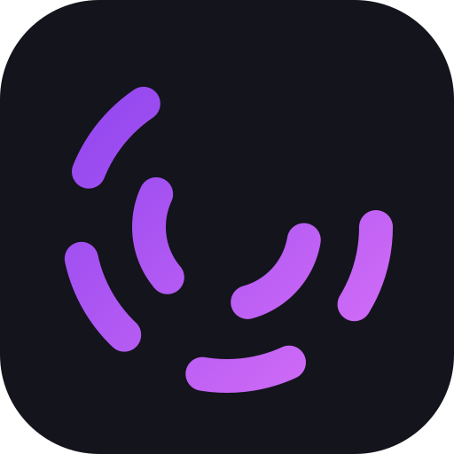
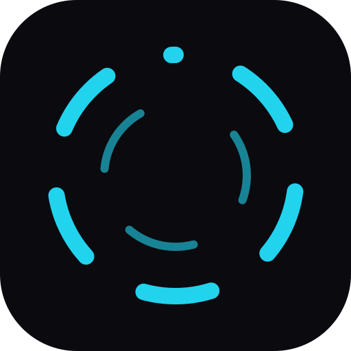
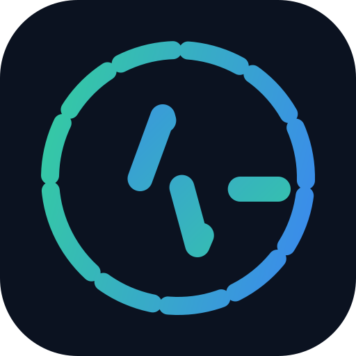
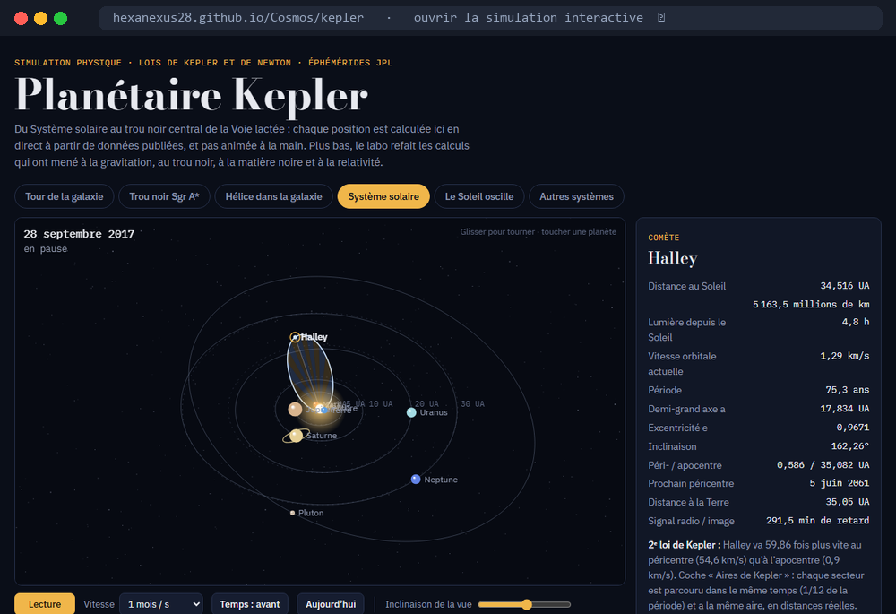

  

  <a href="https://yawo-portfolio.vercel.app">Portfolio</a> ·
  <a href="https://www.linkedin.com/in/yawozoglo">LinkedIn</a> ·
  <a href="README.md">Version française</a>

Software and AI engineering apprentice at [ESIEA](https://www.esiea.fr), based in Paris.
**I build platforms, not pages**: a shared core (one database, one account, one error log), apps that plug into it,
and the infrastructure that keeps them running in production.
My line: *less but better*, and *if it's complicated, it's badly designed*.

## The ShiftStar ecosystem

ShiftStar (challenges, votes and rankings for restaurants, in production since February 2026) is not a standalone
app: it is a core and modules that plug into it. SkillScan is one, others serve administration. They share one
database isolated per site (RLS), whose chosen access principle is to read under RLS and write through RPCs, and every
module's errors flow into a console. All of it runs on a
VPS managed with Ansible. The code is private, so here is the architecture.

## Delivered products

Live products built for their owners. The code is theirs, so they are described here without being exposed.

<table>
  <tr>
    <td width="76" valign="top"></td>
    <td><b><a href="https://edusocialnews.com">EduSocialNews</a></b> French-language education platform: articles, books, podcasts and quizzes. Moved in June 2026 from its former host to a Docker VPS. Laravel 9 · PHP 8.2 · MariaDB · Docker · Ansible</td>
  </tr>
  <tr>
    <td width="76" valign="top"></td>
    <td><b>La Magnificience</b> SaaS of quizzes aligned with the official curriculum (APC) for Togolese middle schools: math formulas, geometry figures, and student progress that follows them across phones, including offline. In pilot. React 19 · Supabase · KaTeX · multi-tenant</td>
  </tr>
  <tr>
    <td width="76" valign="top"></td>
    <td><b><a href="https://profilux.vercel.app">Profilux</a></b> One profile entered once, two outputs: a PDF resume that ATS systems actually read (selectable text, controlled reading order even in two columns, ATS score out of 100) and a public, indexed web portfolio in 6 themes. Next.js 15 · Supabase · react-pdf</td>
  </tr>
</table>

## Open source

<table>
  <tr>
    <td width="76" valign="top"></td>
    <td><b><a href="https://github.com/HexaNexus28/Rondo">Rondo</a></b> YouTube music player in a borderless window or a 340 × 84 px mini card, always on top while you work. Ctrl+V adds a whole playlist; no account, nothing is collected. Electron · React 19 · Vite</td>
  </tr>
  <tr>
    <td width="76" valign="top"></td>
    <td><b><a href="https://github.com/HexaNexus28/Orion">ORION</a></b> Personal AI assistant: 24 tools including Windows desktop actions, confirmation before any destructive action, long-term memory, and a decider that chooses to emit, defer or drop each notification. .NET 9 · React 19 · Three.js · pgvector</td>
  </tr>
  <tr>
    <td width="76" valign="top"></td>
    <td><b><a href="https://github.com/HexaNexus28/pulse-watch">PulseWatch</a></b> Tech watch: your RSS feeds, trends computed per category (TF-IDF) and a digest where an AI agent checks every claim against its sources before publishing. ASP.NET Core · React 19 · Google ADK</td>
  </tr>
  <tr>
    <td width="76" valign="top"></td>
    <td><b><a href="https://github.com/HexaNexus28/nexus-switch">Nexus Switch</a></b> Launches Claude Code on 8 AI providers, free tiers first: models sorted cheapest-first, real cost shown before launch, keys protected by the OS. TypeScript · Ink · npm</td>
  </tr>
</table>

## Hobbies

**Kepler Planetarium**: planets of the Solar System up to the galaxy's central black hole, computed live from JPL data. [Open the simulation](https://hexanexus28.github.io/Cosmos/kepler/) The [Cosmos research notebook](https://github.com/HexaNexus28/Cosmos) extends the approach to the scale of the universe.

## Contact

[Portfolio](https://yawo-portfolio.vercel.app) · [LinkedIn](https://www.linkedin.com/in/yawozoglo)
